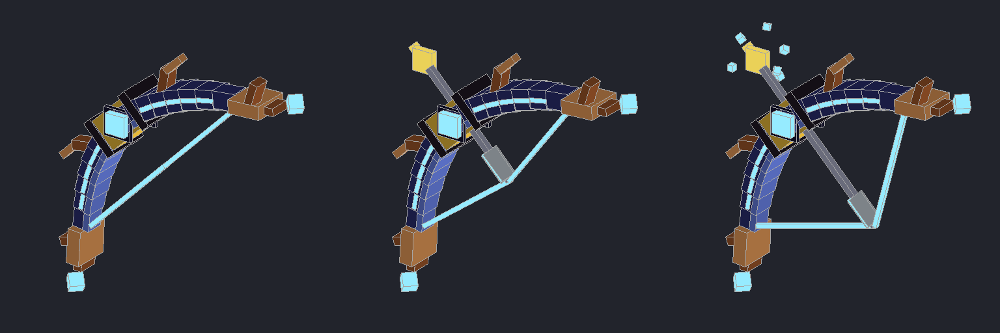
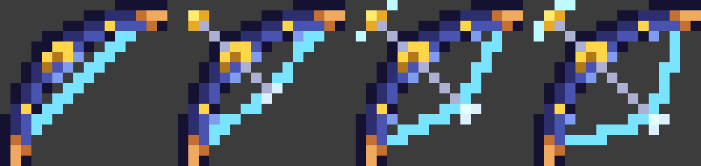

# Stormcaller Bow

A Fabric mod for **Minecraft 26.2** that adds a bow that calls down lightning.



In your hand and on the ground the bow is a **3D model**: thick indigo limbs with glowing energy veins, copper blade tips and wing fins, a gold grip with a glowing lightning gem, floating storm crystals, an animated glowing string, and a charged arrow with 3D fletching and sparks that multiply as you draw. The glowing parts stay bright in the dark. The model is generated by `tools/gen_bow_model.py`.



In the inventory it shows the pixel-art icon. That icon has storm-indigo limbs with copper tips, a gold grip, a glowing cyan string, and a charged arrow that sparks as you draw. The icon textures are generated by `tools/gen_bow_texture.py`.

## What it does

Shoot any mob (or player) with the **Stormcaller Bow**:

1. **Hit:** the arrow doesn't do normal damage. The target freezes, glows, and a chime rings out.
2. **Rising (~1.7 s):** the target floats about 4 blocks into the air, spinning faster and faster. A crackling double helix of energy wraps around it, a ring of soul fire circles the ground, and a dark storm cloud gathers overhead while thunder rumbles and the charge builds.
3. **Trembling:** just before the strike, the target shakes violently.
4. **Strike:** a lightning bolt hits the target and four more hit the ground around it. You get a blinding flash, a sonic boom, a sphere of sparks and fireworks, and a shockwave that rolls across the ground. The target dies.
5. **Aftermath:** the charred, burning body falls, its soul spirals up out of it, and ash drifts down from the fading cloud.

The lightning is visual only, so it won't set fires or hurt anything nearby. Arrows from the bow leave a crackling electric trail while they fly.

## Getting the bow

- **Creative:** Combat tab, right after the normal bow.
- **Crafting:**

  |                |                |                |
  |----------------|----------------|----------------|
  |                | Lightning Rod  |                |
  | Copper Ingot   | Bow            | Copper Ingot   |
  |                | Glowstone Dust |                |

## Install

1. Install [Fabric Loader](https://fabricmc.net/use/) for Minecraft 26.2.
2. Put [Fabric API](https://modrinth.com/mod/fabric-api) and `stormcaller-bow-1.0.0.jar` into your `mods` folder.

## Building

Requires **Java 25**.

```sh
./gradlew build      # jar ends up in build/libs/
./gradlew runClient  # launch a dev client with the mod
```
